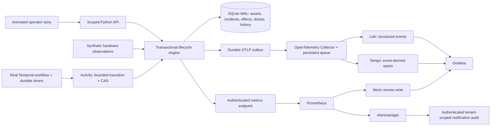

# An observable fleet repair loop

The unit of success is **qualified, useful capacity**, with evidence explaining why it was admitted, withheld or returned. This document describes the independent lab. [research-map.md](research-map.md) identifies the narrower facts published by Nscale.

## Executed architecture

The control API and telemetry delivery are separate paths. A backend outage must not erase the committed incident or make an unvalidated asset eligible. Alertmanager notifications are audited and deduplicated; their text is **not executable repair authority**. The lab's deterministic policy evaluates fresh observations before creating a repair intent. A production adapter could use that intent to start a workflow, with the same admission and authorization boundary.

The real Temporal integration executes engine activities, sleeps durably at the human boundary, and recovers after its worker stops. SQLite remains the authoritative effect ledger for this single-host lab. An activity retry compares the persisted incident version before doing work. A committed transition returns its existing version; it cannot silently perform the next action as the same retry.

## Lifecycle and quality gates

`discovered → qualifying → available → allocated → quarantined → repairing → validating → allocated/available → retired`

Lifecycle describes eligibility, health describes `healthy/degraded/unknown`, and freshness describes how much trust to place in the observation. They are separate. A scheduler must check all three. The implementation records synchronous qualification transitions in history; intermediate states can be short lived inside a transaction.

1. Discover a stable fictional asset identity, placement, serial, firmware baseline and GPU count.
2. Evaluate a versioned qualification suite. Simulated CPU/memory, device, collective, storage, firmware and thermal checks have explicit expectations. Physical GPU burn-in is always skipped.
3. Allocate only fresh, healthy, available capacity. Retired and withheld assets cannot be allocated.
4. Require three persistent simulated symptom observations before opening an incident. A unique active-incident index deduplicates concurrent creation.
5. Isolate the asset and coordinate a simulated workload pause. This lab does not kill or reschedule a real distributed job.
6. Select a versioned allowlisted SOP. Physical repairs create one stable ticket with site/rack/slot/serial and a concrete instruction. Remote thermal remediation uses a bounded simulated action.
7. Technician completion records the action. Requalification and fresh health establish recovery. Failed validation stays quarantined, with a bounded retry budget and escalation.
8. On workload release, recheck the baseline before returning idle capacity. Retirement retains history; real credential revocation and data erasure are explicitly outside execution.

## Invariants reviewers should test

| Invariant | Mechanism | Boundary |
|---|---|---|
| A tenant cannot read or mutate another tenant's asset | Token-derived tenant; tenant-qualified lookup on every operation | Demo static tokens, not production identity federation |
| One active incident per tenant/asset | SQLite unique partial index plus `BEGIN IMMEDIATE` | One SQLite writer; no multi-region consensus |
| One physical ticket per incident | Stable ticket ID, unique incident key, effect transaction | Real external ticket API must honor an idempotency key |
| A duplicate/stale transition cannot advance another stage | Required API expected_version and compare-and-swap | Direct internal engine callers may opt out; Temporal adapter supplies versions |
| Missing telemetry does not become healthy | Freshness TTL, unknown state, action gate | Synthetic source; no collector-coverage discovery in this lab |
| A closed task does not establish recovery | Separate completion and validation transitions | Simulated qualification, not a physical certificate |
| Telemetry outage does not drop committed history | Transactional event outbox, per-signal acknowledgements | At-least-once delivery; Collector acceptance is not permanent backend storage |
| Financial exposure is not double counted within a job | Union overlapping incident windows, intersect job lifetime | Assumed rate; no invoice, energy or cash-saving claim |

An observation's arrival is not proof of causality. Persistent samples in the lab select a known injected fault. Real diagnosis needs topology, baseline deviation, component counters and workload evidence. Source sample identity/deduplication, clock skew handling and independent validation are production requirements. The lab rejects future timestamps and ignores older observations, but does not model a distributed source sequence protocol.

## Telemetry contracts

Metrics carry bounded identity: tenant, site, asset, source and lifecycle state. Trace/incident/job IDs belong in structured events or trace attributes, not metric labels. `lab_fabric_errors_total` is cumulative; query its rate over a useful window, accounting for resets. Temperature, age, state and utilization are gauges. Utilization is not productive output.

The event envelope preserves observed time, ingestion time, tenant, asset, incident, sequence, trace ID, span ID and policy version. OTLP logs export richer context as attributes. Loki indexes low-cardinality resource context; incident IDs remain structured metadata. Tempo spans describe control-plane transitions derived from events. They do **not** measure GPU kernel or collective duration. Correlation links improve investigation, without converting an association into a causal conclusion.

Freshness, dropped/queued delivery, query errors, missing expected targets, schema changes, counter resets, scrape coverage and clock skew deserve their own observability. This lab implements freshness, queue depth and durable delivery tests. Its live metrics do not claim a complete coverage inventory or production telemetry SLO.

## A principal-level production design extension

This section is a proposed design, not implemented scale and not an assertion of Nscale internals.

**Start with requirements.** Define regional/site boundaries; asset and GPU counts; source cadence; tenant contracts; isolation requirements; detection latency; data residency; recovery objectives; retention; and which repairs can be automated. Separate internal operator access from customer telemetry access. Establish the inventory authority and which team owns each signal and action.

**Collect locally and aggregate by failure domain.** Node exporters, NVIDIA DCGM, fabric/switch telemetry, storage, BMC/DCIM and scheduler events join through versioned physical/topology identity. Site gateways bound WAN dependence, retain a bounded disk queue, enforce schemas and apply per-source budgets. Independent synthetic/canary probes detect collection blind spots. A site failure must not simultaneously erase detection, control authority and escalation history.

**Size before picking partitions.** For an illustrative 500,000-node design with 400 retained active series/node and a 15-second interval: 200 million active series, about 13.33 million samples/second, and 1.152 trillion samples/day. At an explicitly assumed 2 compressed bytes/sample, samples alone are about 2.304 TB/day before index, WAL, replication, exemplars and head-memory overhead. Measure actual bytes/sample and series churn; those dominate whether this estimate is useful. Size logs/traces separately from actual measured rates and sampling rules. Asset IDs are high cardinality but bounded and operationally useful; an unbounded process/job/run dimension multiplies the footprint.

**Keep blast radius bounded.** Use regional ingestion/query cells, per-tenant limits and fair query scheduling. Partition by stable ownership/failure boundaries, avoid one fleet-wide scrape or unbounded fanout query, and precompute common fleet rollups. Retention tiers and workload-aware sampling control cost. Incident evidence may require longer retention than noisy routine debug data.

**Design action admission separately.** Freshness, inventory membership, maintenance state, confidence, workload owner approval, quorum/remaining capacity, concurrent repair limits, versioned SOPs and a kill switch precede a repair. Use durable workflow history and idempotent external operations. Reconcile ambiguous timeouts before retrying an irreversible external effect. A distributed job may need checkpoint/cordon/drain coordination across its gang, not a per-node reboot.

**Migrate with evidence.** Inventory current sources and owners; shadow ingestion and evaluate semantic parity; run query/dashboard contract checks; canary one rack/site and repair class; compare detection coverage, false positives, telemetry loss and cost; roll back by explicit criteria. Expand authority only after observed reliability. Funding, staffing, ownership and on-call readiness are design inputs.

## Outcome and operating measures

Agree definitions and denominators before setting targets. Useful measures include qualification escape rate, workload interruption rate, time to safely isolate, time waiting for parts, repair success after validation, repeat failure by component cohort, telemetry freshness/coverage, ingestion loss, query success/latency, and cost per useful GPU-hour or successful inference outcome. Distinguish detection latency from ingest lag and actual outage duration. Treat unresolved incidents as censored when measuring time-to-recovery distributions; averages of only completed repairs hide long failures.

Suggested initial SLOs are **proposals to negotiate**, not measured achievements: 99% of expected asset health observations younger than 30 seconds within a site; 99.9% authenticated control reads successful; a defined detection-to-isolation objective per eligible failure class; and zero unvalidated returns. Runbooks require a named owner, escalation route, evidence query and safe action boundary. Page humans for actionable impact; use tickets and trend review for slow deterioration.

The capacity exposure calculation counts allocated GPU-hours associated with the union of incident intervals. It does not prove that every GPU was idle, recoverable, billable, or economically lost. Compare it with actual progress, checkpoint/restart behavior, spare capacity, power and commercial terms before making a financial decision.
