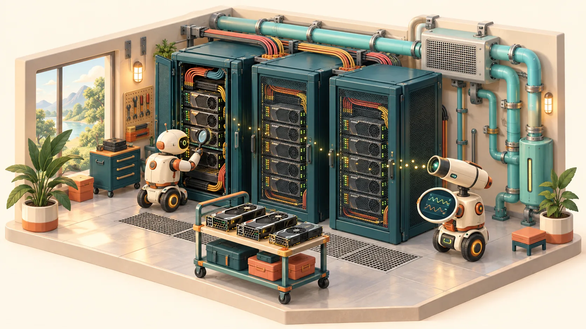
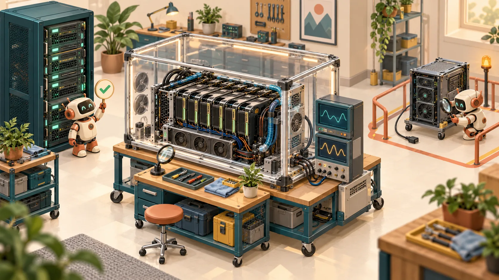
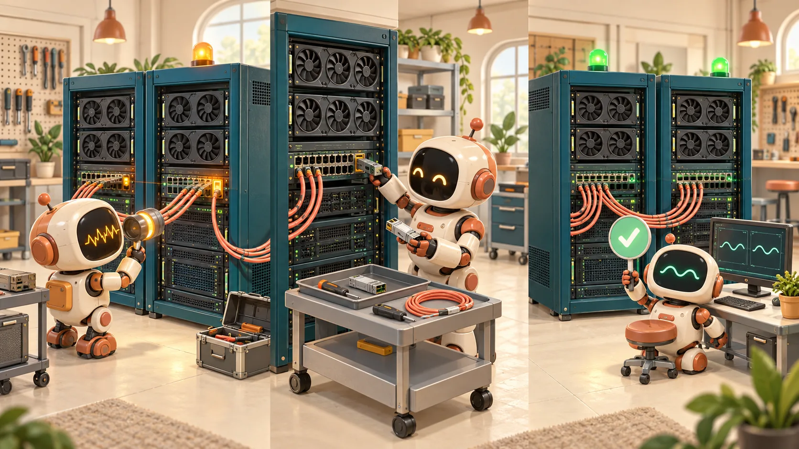

# From public fleet architecture to an independent reliability lab

This document connects public Nscale engineering descriptions to the questions an observability platform must answer. It distinguishes **published facts**, **engineering interpretations**, and **reference-design choices in this repository**. This project is independent, unaffiliated, and does not reproduce Nscale's internal software.

The [blog corpus inventory](blog-corpus.md) records article titles and source URLs examined for this research. The explanations below concentrate on the relevant primary engineering posts. Article text, proprietary diagrams, private resumes and employer materials are not included in this repository.



*An original illustration for this project. It is a conceptual teaching scene, not an image of a Nscale facility or software interface.*

## 1. The published operating model

Nscale describes Fleet Operations through three responsibilities: **Control Center** manages hardware lifecycle automation; an **observability platform** supplies cross-stack signals; and **Radar API** connects operational events with service-management integrations. The post names **Temporal**, **Grafana Mimir**, **Loki** and **Tempo**, and describes connections to DCIM and ITSM systems. This establishes responsibilities and named technologies, rather than a complete deployment topology. [Primary source: Fleet Operations](https://www.nscale.com/blog/fleet-operations).

The useful architectural interpretation is a loop:

1. Establish which physical asset and allocation a signal describes.
2. Detect a symptom and assess its workload impact.
3. Choose an authorized, bounded action.
4. Coordinate remote work or physical intervention.
5. Verify the quality contract before restoring eligibility.
6. Preserve history so recurrence can change the next decision.

The interpretation above is an engineering framework for this lab. It is not a claim about unpublished Nscale message ordering, APIs or decision thresholds.

| Plane | Decision | Failure if the boundary is blurred |
|---|---|---|
| Fleet lifecycle | Does this machine qualify for service? | A reachable node is mistaken for validated capacity. |
| Workload orchestration | Which eligible resources should execute this job? | Free GPU count hides placement or topology constraints. |
| Inference serving | How should requests be routed, queued and batched? | A healthy cluster can still deliver poor user latency. |
| Observability | What happened, where, and with what impact? | Missing or stale evidence becomes a false diagnosis. |
| Repair control | Which action is permitted, and did it work? | Duplicate or premature actions increase the incident's scope. |

## 2. What sits beneath a workload

The bare-metal engineering article describes an underlay Kubernetes cluster, customer control planes using **vCluster** with dedicated worker nodes, direct GPU/RDMA access and topology-sensitive placement. It also describes managed Slurm using **Slinky**, **GRES** and **Pyxis**. These are public statements about a described architecture path, not proof that every product or hardware generation has the same implementation. [Primary source: Bare-metal performance](https://www.nscale.com/blog/bare-metal-performance).

Current customer documentation describes on-demand compute pools and reserved NVIDIA bare-metal pools. It separates provider-operated control-plane monitoring from customer workload monitoring and application-data backup responsibilities. A managed control plane does not establish application reliability by itself. [Primary source: NKS documentation](https://docs.nscale.com/docs/platform-services/managed-kubernetes).

For a reference design, preserve this historical relationship:

```text
site / rack / host / GPU, NIC, drive
              |
region / reservation / placement / cluster
              |
tenant / project / workload / allocation
              |
incident / evidence / procedure version / action / verification
```

Asset identifiers should survive hostname changes. Component and allocation relationships need validity intervals: replacing an optic or moving a workload changes which evidence applies. Hardware signals do not automatically participate in application traces; correlation depends on identity, topology and time.

## 3. Lifecycle: quality must survive reassignment

The node-lifecycle article describes ingestion from a data-center management system, BIOS/firmware/BMC/network checks and performance validation. It also describes rechecking inactive nodes against a current baseline and introducing new automation with human approval gates. [Primary source: The lifecycle of a node](https://www.nscale.com/blog/lifecycle-of-a-node).

The following is a **proposed teaching model**, not Nscale's internal state names:

| State or property | Meaning | Required evidence |
|---|---|---|
| Discovered | The asset exists in inventory. | Source identity and location. |
| Configured | Intended baseline has been applied. | Configuration/version observations. |
| Qualified | Required checks passed. | Complete, versioned test results. |
| Available | Policy allows allocation. | Qualification plus ownership/capacity policy. |
| Allocated | A tenant/workload owns the resource. | Allocation history and scope. |
| Quarantined | New use is withheld. | Incident and reason for withholding. |
| Awaiting physical work | Human intervention is required. | Specific component/location/procedure. |
| Verifying | Recovery evidence is being collected. | Required checks and policy version. |
| Retired | The asset is outside service. | Decommission and inventory closure. |

Health is a separate observation, not a substitute for lifecycle state. A running resource can be unhealthy; a healthy resource can remain unavailable because it is reserved. “Unknown” should remain explicit when evidence is missing.

## 4. Burn-in: prove correctness, performance and stability

The commissioning description names component/firmware checks, SMART, fabric validation, GPU HPL, NCCL/GPU diagnostics and distributed storage tests, including **kube-perftest** and **BenchmarkSet** sweeps. It does not publish a universal test duration or complete threshold policy. [Primary source: Bare-metal commissioning](https://www.nscale.com/blog/bare-metal-performance).

A later validation article describes representative model workloads and repetitions across independent GPU allocations. Its important implication for this lab is to test repeatability and realistic workload behavior, not just one synthetic peak. [Primary source: Exemplar Cloud validation](https://www.nscale.com/blog/nscale-achieves-nvidia-exemplar-cloud-status-on-nvidia-gb300-nvl72).



**Reference-design acceptance contract:**

- Test outcomes are `PASS`, `FAIL`, `SKIPPED` and `ERROR`.
- A skipped required check does not count as success.
- Results identify the asset, component, test version, hardware/software versions, parameters, topology, timestamps and evidence.
- Baselines compare compatible cohorts and retain variability, not only the fastest run.
- Disruptive tests run on capacity held out of customer use.
- Hardware replacement or relevant drift can require requalification.

The CPU-compatible lab can exercise these policy rules without proving actual GPU performance. Real device experiments require supported hardware, tools and access. NVIDIA's documentation explains DCGM diagnostic checks and their limits; DCGM Exporter exposes selected GPU telemetry in Prometheus format. [DCGM diagnostics](https://docs.nvidia.com/datacenter/dcgm/latest/user-guide/dcgm-diagnostics.html), [DCGM Exporter](https://docs.nvidia.com/datacenter/dcgm/latest/gpu-telemetry/dcgm-exporter.html).

## 5. Observability becomes break-fix through an evidence contract

The self-repair article describes diagnosis across compute, memory, networking and storage; remote remedies; precise physical-work tickets; automated validation; and permanent repair history. Its published illustration includes Jira and versioned procedures. The exact internal scheduling and confidence policy remain unpublished. [Primary source: The GPU fleet that fixes itself](https://www.nscale.com/blog/the-gpu-fleet-that-fixes-itself).



An illustrative incident is a slow distributed job with normal local GPU tests but a degraded communication path. The investigation joins job/rank progress, fabric evidence and component inventory. A repair request identifies the correct endpoint and procedure. Completion starts revalidation. If checks still fail, the resource remains withheld.

For a reference implementation, the critical invariants are:

1. Missing telemetry cannot authorize a speculative hardware reset.
2. A caller cannot supply arbitrary tenant context to gain control of another asset.
3. Repeated commands cannot create duplicate logical actions.
4. A stale completion cannot overwrite a newer incident.
5. A technician's completion cannot bypass the verification policy.
6. Timeouts preserve uncertainty until reconciliation establishes external state.

Durable workflows help coordinate long waits, retries and recovery. External effects still need idempotency or reconciliation; persistence alone cannot provide exactly-once physical effects. [Primary source: Temporal activity definition](https://docs.temporal.io/activity-definition).

## 6. What each telemetry technology contributes

| Technology | Intended responsibility | What the name alone does not establish |
|---|---|---|
| Prometheus interfaces | Collection/query contracts and alert-rule inputs. | End-to-end data delivery or valid semantics. |
| Mimir | Metrics backend named in public fleet material. | Actual retention, replication or production sizing. |
| Loki | Log backend named publicly. | A safe label schema or absence of sensitive data. |
| Tempo | Trace backend named publicly. | Complete request coverage or correct sampling. |
| OpenTelemetry Collector | Proposed lab collection/export path. | Durable delivery without configured and tested behavior. |
| Temporal | Named fleet workflow coordination; optional lab integration. | Automatic idempotency of device or ticket operations. |
| Grafana | Investigation views in the reference stack. | Correct units, fresh data or trustworthy queries. |
| Inventory / incident store | Reference source of identity and durable decisions. | Authority over the scheduler or hardware without an integration. |

Collector acceptance, persistence, export, backend ingestion and query visibility are distinct checkpoints. Configure bounded queues, retries and persistent storage, then test the relevant crash/outage. [OpenTelemetry Collector resiliency](https://opentelemetry.io/docs/collector/resiliency/).

Use bounded metric dimensions and deliberate log-stream labels. Keep request IDs and detailed incident context in appropriate traces, logs or metadata instead of multiplying ordinary time series. [Grafana Loki cardinality guidance](https://grafana.com/docs/loki/latest/get-started/labels/cardinality/).

## 7. Workload and cost: measure useful output

Nscale's latency discussion treats TTFT as a cross-stack outcome and explains the batching tradeoff between latency, throughput and cost. Its economics article argues that a cheaper token need not mean a cheaper successful outcome when retries or weaker answers add work. [Primary sources: Full-stack performance](https://www.nscale.com/blog/why-ai-performance-is-a-full-stack-question), [Enterprise AI economics](https://www.nscale.com/blog/the-new-economics-of-enterprise-ai).

Reference measurements should reflect the workload:

| Concern | Useful measurements | Interpretation caution |
|---|---|---|
| Training | Queue wait, step-time distribution, useful throughput, checkpoint/restart loss. | One slow participant can gate collective progress. |
| Inference | Queue, TTFT, inter-token latency, error rate, throughput, task quality. | Define client/server timing and segment request sizes. |
| Hardware/fabric | Errors, throttling, power, memory, link and collective performance. | Activity does not prove productive work. |
| Fleet | Qualified/available capacity, repair age, recurrence, feasible placement. | Installed GPU count is not usable capacity. |
| Telemetry | Freshness, source coverage, delivery loss, query correctness and cost. | Healthy processes do not prove end-to-end evidence. |
| Economics | Cost per successful run/task, affected GPU-hours, energy per useful output. | Capacity exposure is not automatically cash savings. |

For a hypothetical 1,024-GPU synchronous job stalled for ten minutes, exposure is `1,024 * 10/60 = 170.7 GPU-hours`. Applying an **assumed** value of `$3/GPU-hour` gives `$512` of exposure. These are illustrative assumptions, not Nscale pricing or measured lab savings. Avoid double counting stalled time and recomputation.

## 8. What is known, inferred and still to measure

| Status | Examples |
|---|---|
| Publicly documented | Named fleet components and backends; described lifecycle, diagnostics and human-repair loop. |
| Engineering interpretation | Why stable identity, historical allocation and workload impact are needed to investigate across layers. |
| Reference design | Explicit lifecycle states, required-check gates, tenant-scoped commands, durable event history, verification invariants. |
| Executed evidence | Only results recorded by this repository's current tests and verification artifacts. |
| Unestablished | Nscale's private thresholds, retention rules, exact collector topology, internal APIs and production repair policy. |

The default simulator, optional service configuration and real GPU validation are different evidence levels. Read the repository's implementation and run records before claiming that a service or hardware experiment executed. See also the [public Principal design and code-review exercises](principal-interview.md).
